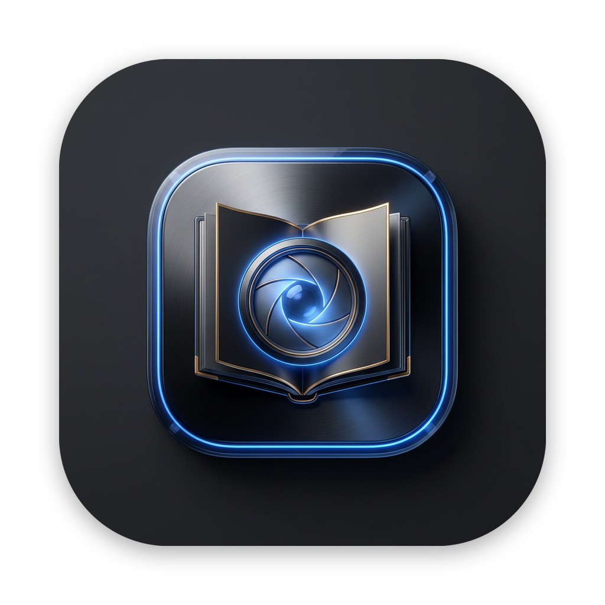

# 📸 ALBUM LAB PRO — Photography Studio & Lab Management System

<p align="center">
  
</p>

<p align="center">
  <strong>Piattaforma Desktop & Server per la gestione della produzione fotografica di alta gamma, cataloghi album nozze, ritaglio calibrato a 300 DPI con gestione profili ICC e trasmissione ordini in tempo reale.</strong>
</p>

<p align="center">
  
  
  
  
  
  
  
  
</p>

---

## 🎯 Il Problema & La Soluzione

Nel settore dei laboratori fotografici e della legatoria artigianale di album matrimoniali e stampe professionali, la comunicazione tra fotografo e stampatore è storicamente problematica:
- Invio di file tramite servizi esterni (WeTransfer, Drive) senza specifiche tecniche formattate.
- Disallineamento dei formati e tagli errati delle teste degli sposi o dei dettagli critici.
- Alterazioni cromatiche causate dalla perdita dei profili colore originali durante la compressione.
- Errori umani nella trascrizione dei nomi degli sposi per l'incisione e nella scelta dei campionari di tessuto o pelle della copertina.
- File omonimi provenienti da corpi macchina diversi (es. `DSC_0001.JPG`) che si sovrascrivono a vicenda.
- Rigidità dei software tradizionali che forzano le foto singole nei cataloghi album o viceversa.

**Album Lab Pro** risolve questi problemi con un'architettura integrata e una modalità duale dedicata:
1. **Modalità Duale Studio & Minilab:**
   - **📖 Stampa Album:** Flusso per fotolibri e album nozze vincolato al catalogo modelli, campionari pelle/tessuto reali, cofanetti coordinati e incisione a caldo dei nomi sposi.
   - **🖼️ Stampe Fotografiche Singole:** Pipeline veloce da banco per foto sciolte e ingrandimenti (da 10x13 a 70x100), moltiplicatore copie per foto o in blocco ("Applica a Tutte") e supporto carte minilab dedicate (*Lucida, Satinata, Seta*).
2. **Client Desktop per il Fotografo:** applicazione grafica *Dark Studio* con ritaglio calibrato a 300 DPI, maschera semi-trasparente Lightroom-style, controllo conflitti busta in tempo reale e trasmissione streaming.
3. **Server & Dashboard Web per il Laboratorio:** server centralizzato che riceve l'ordine in streaming, visualizza i lavori in arrivo su una dashboard aggiornata in tempo reale con toast notifications, genera la **Scheda Commessa A4 stampabile con codice a barre** e compila automaticamente l'archivio ZIP pronto per i minilab di stampa.

---

## 🏛️ Architettura di Sistema

```
┌────────────────────────────────────────┐                 ┌────────────────────────────────────────┐
│         CLIENT FOTOGRAFO               │                 │         SERVER LABORATORIO             │
│       (Album Lab Pro Desktop)          │                 │     (Flask API & Web Dashboard)        │
│                                        │                 │                                        │
│  • Galleria Catalogo (18 Modelli)      │  HTTP POST      │  • Storage Commesse (server_data/)     │
│  • Motore Vincoli Formati & Materiali  │  Multipart      │  • Dashboard Produzione (/admin)       │
│  • Editor Ritagli (300 DPI + ICC)      │  Streaming      │  • Scheda Commessa A4 con Barcode      │
│  • Deduplicazione Nomi Multi-Camera    │ ──────────────> │  • Generatore ZIP Stampe per Minilab   │
│  • Dati Sposi, Busta e Note Tecniche   │  (Chunked)      │  • Macchina a Stati (Attesa->Pronto)   │
│  • Modale Upload con Monitoraggio MB/% │                 │  • Tunnel Cloudflare per Accesso Remoto│
└────────────────────────────────────────┘                 └────────────────────────────────────────┘
```

---

## 💡 Punti Chiave di Ingegneria Software

### 1. Elaborazione Immagini Non Distruttiva & Profilo Colore ICC
- **Calibrazione a 300 DPI:** I ritagli non scalano l'immagine visibile a schermo, ma mappano le coordinate relative normalizzate sulla matrice dell'immagine nativa ad alta risoluzione (24-50+ MP).
- **Integrità Cromatica ICC:** Preservazione trasparente del payload binario del profilo colore nativo (sRGB, Adobe RGB 1998, ProPhoto RGB) durante la scrittura JPEG, prevenendo qualsiasi "color-shift" nei plotter professionali e nei minilab a ioduro d'argento.
- **Maschera Ritaglio Semi-Trasparente Lightroom-Style:** Visualizzazione opaca ad alta luminosità (~42%) delle aree esterne scartate tramite accelerazione PIL LUT (< 0.5 ms per frame), consentendo all'operatore di non perdere mai il contesto visivo della composizione ed evitando il buio totale dei vecchi software.
- **Normalizzazione Aspect Ratio:** Algoritmo per rilevare e avvisare in caso di disallineamento geometrico tra il sensore fotografico (es. 3:2) e il formato di stampa selezionato (es. 4:5 o quadrato 1:1).

### 2. Motore Catalogo Album & Pipeline Stampe Singole
- **Catalogo Linea Estro Wedding (18 Modelli):** Vincoli condizionali rigidi su formati ammessi (quadrati, panoramici, verticali), carte interne (*Lucide, Satinate, Velvet HD, Tela Fine Art*), campionari colore abbinati (*Vellutino, Canapina, Tacto, Wood, Tweed, Zebrano, Spigato, Coagulato*) e incisione nomi sposi.
- **Pipeline Stampe Fotografiche Singole:** Flusso rapido da banco per stampe e ingrandimenti su supporti minilab fisici (*Lucida* come standard predefinito, *Satinata*, *Seta*), con pulsanti "⚡ Applica Formato a Tutte", "⚡ Applica Carta a Tutte" e gestione copie rapida per singola foto o in batch.

### 3. Pipeline di Rete con Streaming Multipart e Monitoraggio Byte-by-Byte
- Modulo di trasmissione (`src/services/network.py`) basato su `requests-toolbelt`:
  - Streaming a blocchi per commesse fotografiche pesanti (fino a centinaia di megabyte o gigabyte) evitando l'esaurimento della memoria RAM.
  - Callback di monitoraggio che aggiorna in tempo reale la percentuale e i megabyte trasferiti (`X MB / Y MB`).
  - Threading asincrono disaccoppiato dall'interfaccia utente con supporto per l'interruzione pulita (*cancellation token*).

### 4. Deduplicazione, Buste Progressive & Rilevamento Conflitti
- **Numero Busta Progressivo Intelligente:** Calcolo automatico della prossima busta libera nell'archivio locale con verifica conflitti in tempo reale (`✓ Libero` / `⚠️ Già in uso`) e risoluzione guidata dei duplicati.
- **Prevenzione Sovrascrittura Multi-Camera:** Negli eventi matrimoniali con più fotografi che usano scatti con lo stesso nome (es. `DSC_0001.JPG`), un motore di deduplicazione dinamico genera suffissi progressivi univoci sia in esportazione locale sia sul server (`DSC_0001_stampa.jpg`, `DSC_0001_2_stampa.jpg`), garantendo zero perdite di file.
- **Sanitizzazione Cross-Platform:** Normalizzazione regex dei numeri di busta e dei metadati per evitare caratteri illegali nei filesystem (`/`, `\`, `:`, `*`, `?`), prevenendo errori su Windows e macOS.

### 5. Connettività Zero-Config con Cloudflare Tunnel
- **Avvio 1-Click per il Laboratorio:** Tramite gli script a doppio clic `avvia_laboratorio.command` (macOS) e `avvia_laboratorio.bat` (Windows), il sistema avvia il server, scarica automaticamente il client ufficiale Cloudflare se assente, attiva un tunnel HTTPS cifrato, salva l'indirizzo server in `INDIRIZZO_SERVER_PER_FOTOGRAFI.txt` e apre direttamente la dashboard nel browser del laboratorio (il fotografo non usa il browser, usa esclusivamente l'app desktop!).

### 6. Interfaccia Grafica Dark Studio HiDPI / Retina & Box Note Ergonomico
- Palette cromatica professionale (`#121316`, `#18191C`, `#0078FF`) studiata per evitare l'affaticamento visivo e non alterare la percezione dei colori fotografici.
- Area **Note di Lavorazione** ampliata a 5 righe con scrollbar fluida, bordo ad alto contrasto e placeholder descrittivo per richieste speciali (bordini bianchi, correzioni, finiture).
- Calcolo automatico della scala DPI (`tk scaling`) per garantire pulsanti generosi (36-38px) e tipografia nitida sia su schermi Apple Retina che su monitor PC 1080p/2K/4K.
- Icona macOS conforme agli standard Apple HIG Squircle (raggio continuo e drop shadow morbido).

---

## 🛠️ Stack Tecnologico

| Componente | Tecnologia | Ruolo & Funzione |
|---|---|---|
| **Linguaggio** | Python 3.10+ | Linguaggio principale dell'intero stack |
| **Interfaccia Desktop** | Tkinter / TTK + Pillow | Canvas fotografico interattivo, gallerie responsive HiDPI |
| **Backend & API** | Flask | Endpoint RESTful e rendering server-side dashboard con feedback toast |
| **Image Processing** | PIL / Pillow | Decodifica EXIF, orientamento lossless, salvataggio 300 DPI + ICC |
| **Network Streaming** | Requests & Requests-Toolbelt | Upload multipart streaming chunked ad alte prestazioni |
| **Remote Tunneling** | Cloudflare Tunnel (cloudflared) | Connessione sicura HTTPS da remoto senza configurazione router |
| **Packaging & CI/CD** | PyInstaller + GitHub Actions | Compilazione nativa macOS (.app/.dmg) e build cloud Windows (.exe) |
| **Test Automation** | Python Standard / Requests | Test suite end-to-end e test di robustezza edge cases (100% pass) |

---

## 📁 Struttura della Codebase

```
album-lab/
├── .github/workflows/          # Workflow CI/CD GitHub Actions
│   └── build_windows.yml       # Compilazione cloud automatica di AlbumLabPro.exe
│
├── main.py                     # Entry point applicazione Desktop Fotografo (Client)
├── server.py                   # Entry point Server Laboratorio & Dashboard Web
├── avvia_laboratorio.py        # Orchestratore Server + Cloudflare Tunnel
├── avvia_laboratorio.command   # Lanciatore 1-Click macOS per il laboratorio
├── avvia_laboratorio.bat       # Lanciatore 1-Click Windows per il laboratorio
├── requirements.txt            # Dipendenze Python
├── build_mac.sh                # Script di compilazione per macOS (.app e .dmg)
├── build_windows.bat           # Script di compilazione per Windows (.exe)
├── GUIDA_CLIENT_SERVER.md      # Manuale operativo di collaudo locale e remoto
├── LICENSE                     # Licenza d'uso proprietaria (Showcase)
│
├── assets/                     # Icone native multi-risoluzione (.icns, .ico, .png)
│
├── src/
│   ├── core/                   # Logica di dominio, catalogo e math di ritaglio
│   │   ├── catalog.py          # Definizione modelli, campionari e vincoli (18 modelli)
│   │   ├── config.py           # Gestione configurazioni cross-platform
│   │   ├── constants.py        # Tabella formati stampa e risoluzione percorsi
│   │   ├── exporter.py         # Esportazione 300 DPI + ICC e deduplicazione foto
│   │   └── models.py           # Modello FotoItem (EXIF auto-rotate, crop box normalizzato)
│   │
│   ├── server/                 # Backend del laboratorio e interfaccia di produzione
│   │   ├── app.py              # API REST, Dashboard Web Dark Studio, Toast e Scheda A4
│   │   └── storage.py          # Archiviazione commesse, aggiornamento stati, generatore ZIP
│   │
│   ├── services/               # Comunicazione telematica
│   │   └── network.py          # Streaming multipart e monitoraggio upload progressivo
│   │
│   └── ui/                     # Componenti visuali Desktop
│       ├── catalog_dialog.py   # Galleria visuale con schede prodotto e anteprime
│       ├── editor.py           # Canvas con griglia dei terzi e rotazione orientamento
│       ├── main_window.py      # Finestra principale Album Lab Pro
│       ├── panels.py           # Pannelli laterali dinamici vincolati al catalogo
│       ├── theme.py            # Tema Dark Studio con calcolo automatico HiDPI
│       ├── thumbnails.py       # Griglia miniature fluida con badge quantità e warning
│       └── upload_dialog.py    # Modale di trasmissione con progress bar e test server
│
├── media/                      # Asset grafici e foto del catalogo prodotti
│   └── models/                 # Immagini ufficiali dei modelli album
│
└── tests/                      # Suite di test automatizzati
    ├── test_e2e_orders.py      # Test E2E del flusso Client -> Server -> ZIP -> Scheda A4
    └── test_robustness.py      # Test di robustezza: duplicati, accenti, DPI, sicurezza API
```

---

## ⚡ Avvio & Utilizzo Rapido

### 1. Per il Laboratorio (Ricezione Ordini & Produzione)

Basta fare doppio clic sull'avviatore rapido:
* **Su Mac:** doppio clic su `avvia_laboratorio.command`
* **Su Windows:** doppio clic su `avvia_laboratorio.bat`

Il programma avvia il server, crea il tunnel Internet, apre la Dashboard nel browser del laboratorio su **`http://localhost:5050/admin`** e genera il file **`INDIRIZZO_SERVER_PER_FOTOGRAFI.txt`** contenente l'indirizzo da inserire una sola volta nell'app desktop del fotografo (il fotografo non deve aprire il browser, lavora al 100% all'interno dell'app nativa!).

### 2. Per il Fotografo (Composizione & Invio Commessa)

Avvia l'applicazione desktop (o doppio clic su `AlbumLabPro.app` / `.dmg`):
```bash
python main.py
```
- Sfoglia il catalogo cliccando su **"📖 Sfoglia Catalogo Album"**.
- Carica le foto con **"📂 Carica Foto (Ctrl+O)"** o trascinale nell'editor.
- Inserisci i dati della busta e i nomi degli sposi.
- Clicca su **"🚀 INVIA AL LABORATORIO"** per trasmettere la commessa via streaming.

---

## 🧪 Qualità del Codice & Test Automatizzati

La codebase include due suite complete di test automatizzati che validano sia la pipeline standard sia la robustezza ai casi limite:

### Test 1: Flusso End-to-End di Produzione
```bash
python tests/test_e2e_orders.py
```
* Valida: connessione, calibrazione 300 DPI, streaming multipart, persistenza JSON, aggiornamento dashboard, generazione scheda A4 e integrità download ZIP.

### Test 2: Robustezza & Casi Limite
```bash
python tests/test_robustness.py
```
* Valida: gestione foto con nomi identici da due corpi macchina (`DSC_0001.JPG`), caratteri speciali nel numero busta (`12/2026:Special*Test`), caratteri accentati nei metadati degli sposi (`Éléonore & Nicolò`), rifiuto payload corrotti (HTTP 400) e conformità 300x300 DPI.

### Test 3: Evoluzione di Dominio, Stampe Singole & Buste Progressive
```bash
python tests/test_domain_evolution.py
```
* Valida: pipeline completa stampe singole a 300 DPI, supporti carte minilab (*Lucida, Satinata, Seta*), accelerazione PIL LUT maschera ritaglio semi-trasparente (< 0.5 ms), calcolo automatico buste progressive e rilevamento conflitti/duplicati in tempo reale.

Risultato collaudi:
```text
===========================================================================
TUTTI I TEST END-TO-END E DI ROBUSTEZZA COMPLETATI CON SUCCESSO! (100% PASS)
===========================================================================
```

---

## 📜 Licenza & Diritti

Questo repository è pubblicato **esclusivamente a scopo dimostrativo e di portfolio personale**. Tutti i diritti di proprietà intellettuale, design e codice sorgente appartengono all'autore. È espressamente vietata la riproduzione commerciale, la redistribuzione di binari compilati e l'impiego non autorizzato in ambienti di produzione. Consultare il file `LICENSE` per maggiori dettagli.
